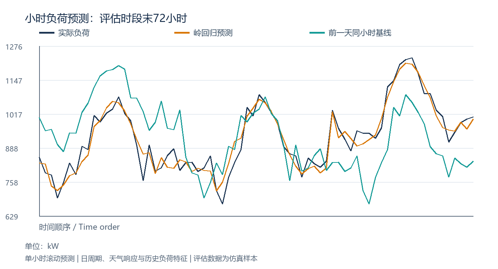
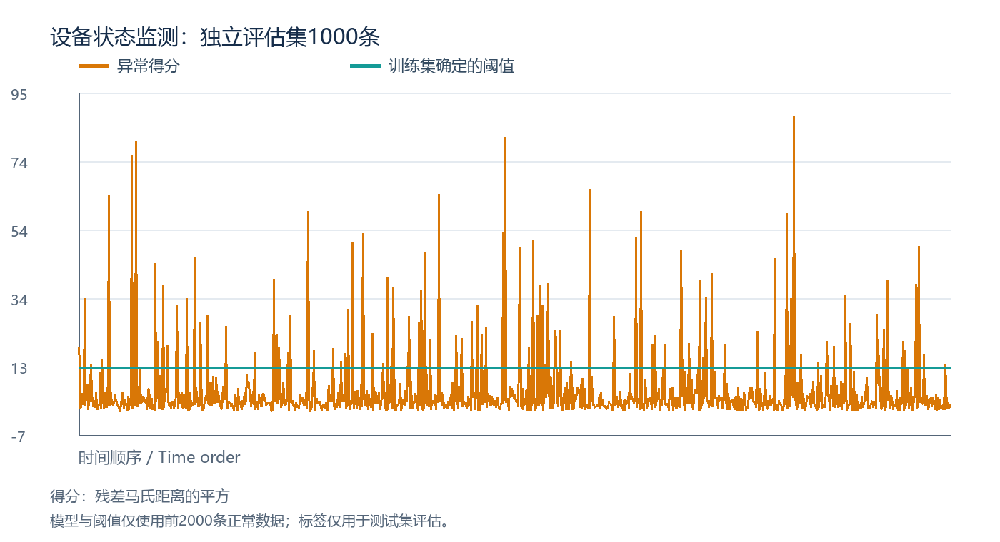

# 陈浩 · 工程数据分析作品集

围绕能源负荷预测与设备状态监测的两个Python工程案例，包含完整算法、可复现数据、模型参数和逐条评估结果。

**[在线作品集](https://chen-hao12.github.io/engineering-data-portfolio/) · [项目报告](docs/downloads/project-report.pdf) · [源码](run_cases.py) · [运行指标](results/metrics.json)**

## 案例一：园区小时负荷预测

用日历、温度响应和历史负荷特征建立单小时滚动预测，并与前一天同小时基线比较。

- **数据**：180天、4320条小时级仿真记录；构造特征后4152条有效样本。
- **划分**：前3432条训练，最后720条独立评估；标准化参数仅由训练数据确定。
- **实现**：pandas时间对齐与滞后特征；NumPy岭回归；9个输入特征、L2系数1、截距不惩罚。

| 指标 | 岭回归 | 前一天同小时基线 |
| --- | ---: | ---: |
| MAE / kW | 30.1058 | 79.3247 |
| RMSE / kW | 37.4005 | 102.4790 |
| MAPE | 3.0787% | 8.2124% |



输入协议为单小时滚动预测，可使用之前已观测的负荷；温度为外生输入。多步日前预测需要重新定义可获得的输入。

## 案例二：旋转设备状态监测与异常识别

先用转速与负载解释振动、温度和电流，再以残差的马氏距离识别相对正常工况的偏离。

- **数据**：3000条10分钟工况仿真记录；前2000条正常样本校准，后1000条独立评估。
- **模型**：工况最小二乘回归、残差均值与协方差、马氏距离平方评分。
- **阈值**：正常训练分数的99.5%分位数；评估标签不参与模型或阈值选择。

| 指标 | 独立评估结果 |
| --- | ---: |
| 精确率 | 94.3925% |
| 召回率 | 84.1667% |
| F1 | 0.889868 |
| 正常样本误报率 | 0.6818% |
| TP / FP / FN / TN | 101 / 6 / 19 / 874 |



评分用于提示异常，不能直接等同于具体故障诊断。

## 本地复现

已验证环境：Python 3.12.14、NumPy 2.3.5、pandas 3.0.1、Pillow 12.3.0。

```sh
python -m pip install -r requirements.txt
python run_cases.py
python verify_results.py
```

建议先执行`python -m venv .venv`创建虚拟环境；在Windows执行`.venv\Scripts\Activate.ps1`，在macOS/Linux执行`source .venv/bin/activate`，然后安装依赖并运行。

运行会重建`data/`和`results/`中的数据、参数、结果CSV和图片。固定随机种子分别为20261008、20261009。

## 文件索引

| 文件 | 内容 |
| --- | --- |
| `run_cases.py` | 两个案例的数据构建、模型、评估与导出 |
| `verify_results.py` | 从逐条结果重新计算指标与混淆矩阵 |
| `data/*.csv` | 连续时序与设备工况仿真样本 |
| `results/metrics.json` | 完整指标、数据划分和运行环境 |
| `results/*.csv` | 逐条负荷预测、基线和设备异常评分 |
| `results/*.npz` | 模型参数和阈值 |
| `docs/downloads/project-report.pdf` | 业务问题、核心算法、实现及评估说明 |
| `docs/index.html` | 在线作品集页面 |

## 数据与适用范围

数据按工程工况规则生成，用于复现和比较算法。指标对应本仓库的独立评估样本，不表示真实园区或设备的生产效果。用于实际业务前，应重新检查数据口径、天气输入、工况变化、传感器漂移和误报漏报成本。
